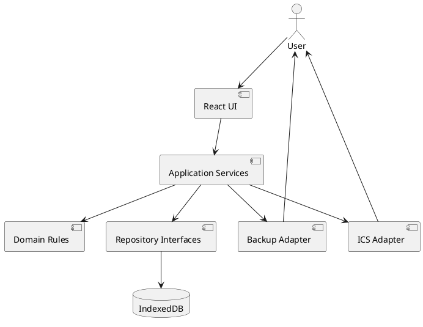
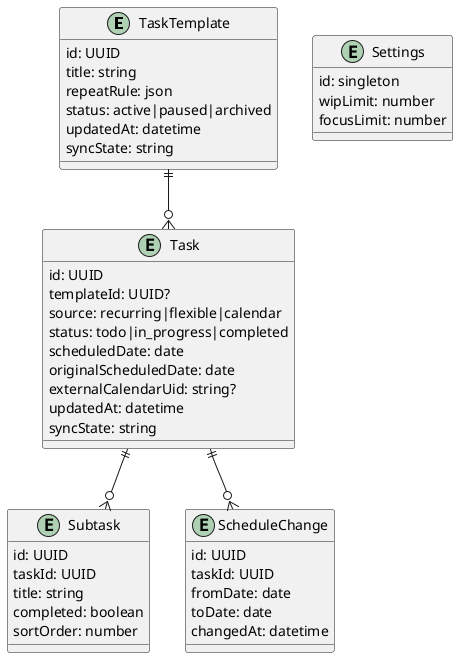

# Design Document

## 1. Technical Architecture

### 1.1 Technology Selection

- Frontend Tech Stack: React + TypeScript + Vite，移动端优先的响应式单页应用
- PWA: `vite-plugin-pwa`，提供安装入口、应用壳缓存与离线启动
- State Management: Zustand，管理界面状态与业务操作编排
- Data Storage: IndexedDB + Dexie.js，保存结构化本地数据并支持事务和索引
- Validation: Zod，用于表单、备份文件和 ICS 映射结果校验
- Date Handling: date-fns，所有“当天”计算使用设备本地时区
- Calendar Interchange: 轻量 iCalendar 解析与生成库，封装在独立适配器中
- Testing: Vitest + React Testing Library，聚焦重复任务、结转、备份和 ICS 互导
- Deployment Environment: 静态站点托管；首版无后端、无账号、无服务器依赖

### 1.2 System Architecture



核心模块：

- 看板模块：展示日期范围内的三栏任务，处理状态流转、筛选和 WIP 限制。
- 任务模块：管理灵活任务、子任务、优先级、时长、截止日期和今日重点。
- 模板调度模块：按本地日期和重复规则幂等生成每日任务实例。
- 历史与统计模块：保存完成快照并计算重复任务连续完成天数。
- 本地持久化模块：通过仓储接口隔离 IndexedDB，保证多表写入的事务一致性。
- 备份模块：每日检查并生成本地版本化快照，按保留策略清理旧快照；提供周期性异地备份提醒、JSON 文件导出，以及经过校验和事务保护的快照/文件恢复。
- ICS 适配模块：负责任务与 iCalendar 事件之间的映射、预览、去重和错误报告。

依赖方向保持为 UI → 应用服务 → 领域规则/仓储接口 → 本地适配器。领域规则不直接依赖 React、Dexie 或 ICS 库，便于后续增加云同步适配器。

## 2. Detailed Design

### 2.1 Frontend Design

#### UI design specifications

- 默认首页为“今天”看板，顶部提供日期切换、今日重点筛选和新增任务入口。
- 移动端三栏不横向同时挤压展示，使用 To Do、进行中、已完成三个分段标签；宽屏时切换为三列。
- 任务卡显示标题、优先级、预计时长、来源、子任务进度、逾期/结转和今日重点标识。
- 点击任务卡打开底部抽屉编辑详情；创建灵活任务采用最少必填字段，其他字段渐进展开。
- 状态流转同时支持拖拽和明确操作按钮，避免触屏拖拽成为唯一交互。
- 模板在独立页面维护，避免与每日实例混淆。
- 历史页面按日期显示完成数量、任务列表和重复任务连续完成情况。
- 设置页提供 WIP 上限、今日重点上限、数据备份恢复和 ICS 导入导出入口。

#### Component design

- `AppShell`: PWA 页面框架、导航和全局错误提示。
- `TodayBoard`: 读取目标日期及结转任务，组织三个状态区域。
- `BoardColumn`: 展示某状态任务并接收状态移动操作。
- `TaskCard`: 展示任务摘要、进度和快捷操作。
- `TaskEditor`: 创建或编辑灵活任务及任务实例。
- `SubtaskList`: 子任务增删改、排序和完成状态管理。
- `TemplateList` / `TemplateEditor`: 固定任务模板管理。
- `HistoryView`: 历史完成记录与连续完成统计。
- `BackupPanel`: 快照列表与恢复、备份提醒设置、文件导出、导入校验和恢复结果。
- `CalendarTransferPanel`: ICS 文件选择、解析预览、选择导入与任务导出。

#### State management

- IndexedDB 是业务数据唯一事实来源；Zustand 仅保存当前日期、筛选器、弹窗状态和查询结果。
- 所有写操作经应用服务完成，成功提交事务后再刷新查询，避免内存状态与数据库不一致。
- 应用启动时先执行数据库打开和迁移，再执行当天重复实例生成，最后加载看板。
- 查询按 `scheduledDate + status` 建立索引；结转任务查询条件为计划日期早于目标日期且未完成。

#### Routing design

- `/today`: 今日看板
- `/day/:date`: 指定日期看板
- `/templates`: 固定任务模板
- `/history`: 完成历史
- `/settings`: 设置、备份和 ICS 互导

### 2.2 Data and Business Design

首版无远程后端和 REST API。应用服务作为本地业务接口，未来云同步通过新增同步网关接入，而不改变 UI 调用方式。

#### Data model design



所有核心实体包含 `createdAt`、`updatedAt`、`syncState` 和稳定 UUID。Task 额外保存标题、描述、优先级、预计分钟数、截止日期、开始时间、完成时间和今日重点标记。实例复制模板当时的展示字段，使历史不受模板修改影响。

`Settings` 还保存自动快照保留数量、异地备份提醒周期、`lastSnapshotAt`、`lastExternalBackupAt` 和 `remindAfter`。`Snapshot` 保存稳定 UUID、快照日期、创建时间、schema 版本、来源及完整业务数据载荷；`snapshotDate` 对自动快照建立唯一索引。

#### Business logic design

- 重复生成：以 `templateId + scheduledDate` 唯一索引保证幂等；启动应用和切换到目标日期时补生成符合规则的实例。
- 状态流转：进入进行中前检查 WIP 上限；进入已完成时写入完成时间；重新打开时清除完成时间。
- 跨天结转：不复制任务，只在今天查询中合并历史未完成项；主动改期时更新计划日期并新增 ScheduleChange。
- 子任务进度：实时按完成数/总数计算，不保存冗余百分比。
- 连续完成：依据模板重复规则生成应执行日期序列，再与已完成实例匹配；暂停区间不计入序列。
- 自动快照：应用完成数据库迁移后检查 `lastSnapshotAt`；距上次快照达到 24 小时则复制当前业务数据至 `snapshots` 表，同一自然日以唯一日期键防止重复创建。
- 快照清理：快照写入成功后按创建时间倒序保留用户设定数量，默认 14 份；清理失败不得影响新快照和业务数据。
- 异地备份提醒：应用启动时比较 `lastExternalBackupAt`、`remindAfter` 与提醒周期，达到周期后显示应用内提醒；浏览器关闭时不尝试后台运行或发送系统推送。
- 备份恢复：快照恢复或文件导入均先解析至内存、校验 schema 和版本，再在单一事务中替换业务表；`snapshots` 表不包含在被替换范围内，失败时整体回滚。
- ICS 导出：无开始时间任务映射为全天事件；有开始时间任务按预计时长计算结束时间，无时长时使用默认 30 分钟。
- ICS 导入：先生成预览项和错误项；以 UID 与事件开始时间组成导入键，已有键默认跳过。

#### Security solution design

- 所有导入内容使用 schema 校验、长度限制和类型白名单，文本仅以纯文本渲染。
- 文件解析在本地完成，不上传备份或 ICS 内容。
- Service Worker 仅缓存静态应用资源，不缓存包含用户业务数据的网络响应。
- 备份文件首版不加密，导出前明确提示其中包含个人任务信息。
- 恢复前生成当前数据库的临时内存快照；事务失败时保留原数据。

### 2.3 Directory Structure Design

```text
src/
  app/                 应用入口、路由与全局错误边界
  features/
    board/             看板、筛选与状态流转
    tasks/             任务和子任务
    templates/         固定任务模板与调度
    history/           完成历史与连续统计
    backup/            JSON 备份恢复
    calendar/          ICS 导入导出
    settings/          本地设置
  domain/              实体、值对象与纯业务规则
  services/            应用用例与事务编排
  repositories/        仓储接口
  infrastructure/
    db/                Dexie 数据库、迁移和仓储实现
    backup/            备份文件适配器
    calendar/          iCalendar 适配器
  shared/              通用组件、日期和校验工具
  tests/               跨模块关键流程测试
```

## 3. Quality Assurance

- Testing strategy: 单元测试覆盖重复规则、幂等生成、WIP 限制、结转、连续完成和 ICS 映射；集成测试使用临时 IndexedDB 验证事务恢复；组件测试覆盖主要表单和看板流转。
- Performance optimization plan: 按日期和状态建立组合索引；列表按需渲染；启动只生成当前访问日期所需实例；避免将完整数据库镜像放入全局状态。
- Security protection measures: 本地文件严格校验、导入大小限制、纯文本渲染、恢复事务回滚和明确隐私提示。
- Monitoring and alerting plan: 首版不接入远程监控；使用全局错误边界、本地结构化错误日志和可复制的诊断信息，不记录任务正文。
- Compatibility plan: 重点验证最新版 Safari iOS 与 Chrome Android 的安装、离线启动、文件导入和下载；不支持能力应提供普通网页降级路径。